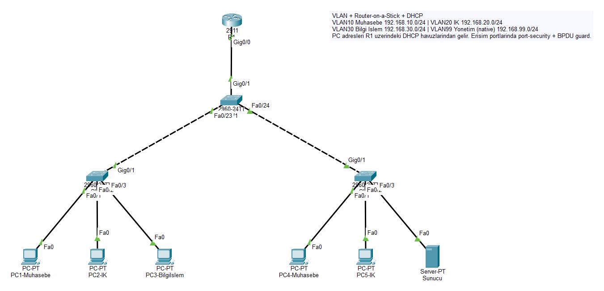
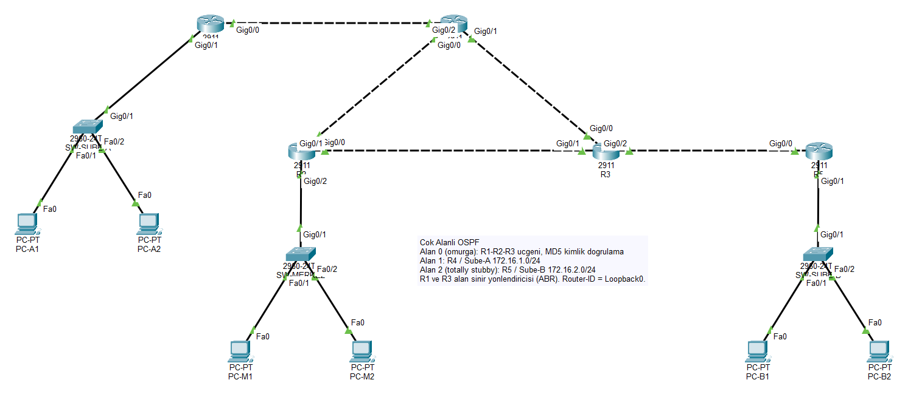
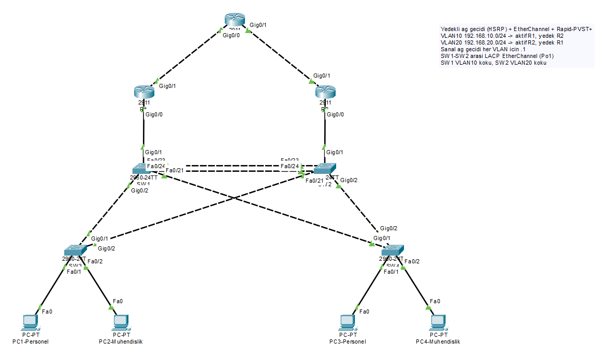
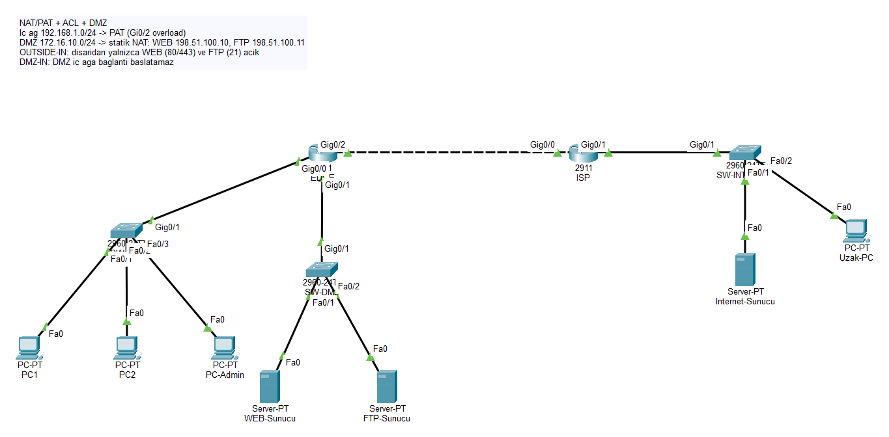
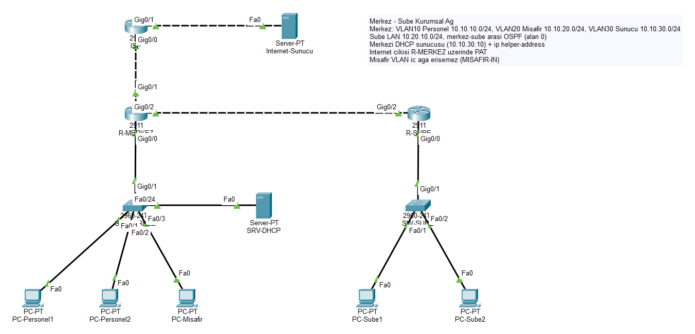
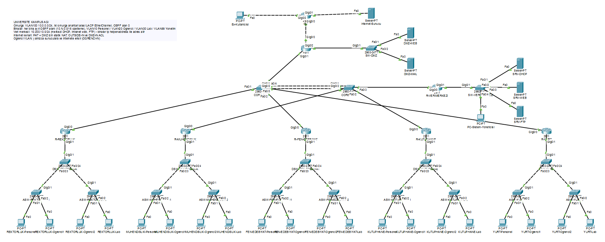
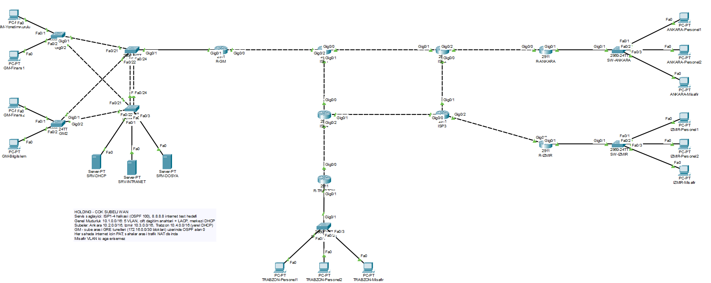

# Cisco Packet Tracer Ağ Topolojileri

Cisco Packet Tracer 9.0 ile hazırladığım yedi ağ tasarımı. İlk beşi tek bir konuya odaklanan laboratuvar çalışmaları, son ikisi ise bu konuları bir araya getiren, bitirme projesi ölçeğinde kapsamlı tasarımlar.

Her klasörde şunlar var:

- `*.pkt` — Packet Tracer dosyası (9.0.0 ve üzeri ile açılır)
- `topoloji.png` — mantıksal çalışma alanının görüntüsü
- `configs/` — yönlendirici ve anahtarların çalışan yapılandırmaları (`show running-config` çıktısı)

| # | Topoloji | Konular | Cihaz |
|---|---|---|---|
| 01 | [VLAN ve Router-on-a-Stick](#01--vlan-ve-router-on-a-stick) | VLAN, 802.1Q trunk, inter-VLAN routing, DHCP, port-security | 10 |
| 02 | [Çok Alanlı OSPF](#02--çok-alanlı-ospf) | OSPF alanları, ABR, MD5 doğrulama, totally stubby alan | 14 |
| 03 | [HSRP, EtherChannel ve Rapid-PVST+](#03--hsrp-etherchannel-ve-rapid-pvst) | Ağ geçidi yedekliliği, LACP, STP kök köprü tasarımı | 11 |
| 04 | [NAT/PAT, ACL ve DMZ](#04--natpat-acl-ve-dmz) | PAT, statik NAT, genişletilmiş ACL, DMZ | 12 |
| 05 | [Merkez–Şube Kurumsal Ağ](#05--merkezşube-kurumsal-ağ) | VLAN, OSPF, merkezi DHCP + relay, PAT, misafir ağı | 12 |
| 06 | [Üniversite Kampüs Ağı](#06--üniversite-kampüs-ağı) | Omurga, bina başına OSPF alanı, veri merkezi, DMZ, internet kenarı | 55 |
| 07 | [Holding – Çok Şubeli WAN](#07--holding--çok-şubeli-wan) | Servis sağlayıcı halkası, GRE tünelleri, OSPF, PAT, yedekli dağıtım katmanı | 31 |

Kullanılan cihazlar: Cisco 2911 yönlendirici, Catalyst 2960-24TT anahtar, PC ve sunucu.

## Dosyaları açmak

1. Depoyu indirin ya da klonlayın.
2. İlgili klasördeki `.pkt` dosyasını Packet Tracer 9.0.0 veya daha yeni bir sürümle açın.
3. Açılıştan sonra protokollerin yakınsaması için kısa bir süre bekleyin (küçük topolojilerde yaklaşık bir dakika, 06 ve 07'de iki–üç dakika). İsterseniz *Fast Forward Time* düğmesiyle hızlandırabilirsiniz.

Tüm cihazlarda `enable` parolası `cisco`'dur (yalnızca laboratuvar amaçlı).

## Doğrulama

Dosyaların hepsi Packet Tracer 9.0.0'da açılıp yeniden kaydedildi; kaydedilen çalışan yapılandırmalar tasarımla satır satır karşılaştırıldı.

| # | Yapılan test | Sonuç |
|---|---|---|
| 01 | 5 PC'nin yönlendiricideki DHCP havuzlarından adres alması | 5/5 |
| 02 | R4'ten (alan 1) alan 0 ve alan 2'deki PC'lere ping, OSPF komşuluğu | Başarılı, komşuluk FULL |
| 03 | HSRP durum geçişleri; R1'den iki VLAN'daki PC'lere ve CORE'a ping | Başarılı |
| 04 | İç ağdaki PC1'den internet sunucusuna ping (PAT üzerinden) | Başarılı |
| 05 | Merkez ve şubedeki 5 PC'nin merkezi DHCP sunucusundan adres alması | 5/5 |
| 06 | 20 PC'nin veri merkezindeki DHCP sunucusundan adres alması; bina yönlendiricisinde OSPF rotaları | 20/20, tüm alanlar öğrenildi |
| 07 | 13 PC'nin adres alması; GRE tünellerinin kurulması | 13/13 |

Ping testlerinde ilk paket ARP çözümlemesi sırasında düşer; bu beklenen davranıştır.

Henüz test edilmeyenler: 04 ve 06'da dışarıdan DMZ'ye statik NAT ile erişim ve ACL'lerin engellediği trafik; 03'te bağlantı koparıldığında HSRP devralması; 07'de şubeler arası tünel üzerinden ping.

---

## 01 — VLAN ve Router-on-a-Stick

Üç anahtarlı küçük bir ofis ağı. VLAN'lar arası yönlendirmeyi tek bir yönlendirici alt arayüzlerle yapar.

| VLAN | Ad | Ağ | Ağ geçidi |
|---|---|---|---|
| 10 | MUHASEBE | 192.168.10.0/24 | 192.168.10.1 |
| 20 | INSAN-KAYNAKLARI | 192.168.20.0/24 | 192.168.20.1 |
| 30 | BILGI-ISLEM | 192.168.30.0/24 | 192.168.30.1 |
| 99 | YONETIM (native) | 192.168.99.0/24 | 192.168.99.1 |

- R1 üzerinde her VLAN için DHCP havuzu; ilk 10 adres hariç tutulur.
- Trunk'larda native VLAN 99 ve izinli VLAN listesi.
- Erişim portlarında port-security (en fazla 2 MAC, sticky, restrict), PortFast ve BPDU guard.
- Kullanılmayan portlar VLAN 999'da ve kapalı.
- SW1 tüm VLAN'lar için kök köprü.

## 02 — Çok Alanlı OSPF

Beş yönlendiricili, üç alanlı bir OSPF tasarımı.

| Alan | Yönlendiriciler | Ağlar |
|---|---|---|
| 0 (omurga) | R1, R2, R3 | 10.0.12.0/30, 10.0.13.0/30, 10.0.23.0/30, 172.16.0.0/24 |
| 1 | R1 (ABR), R4 | 10.1.14.0/30, 172.16.1.0/24 |
| 2 (totally stubby) | R3 (ABR), R5 | 10.2.35.0/30, 172.16.2.0/24 |

- Router-ID'ler Loopback0 adreslerinden (1.1.1.1 – 5.5.5.5).
- Omurgada MD5 kimlik doğrulama.
- Alan 2 totally stubby: R5 yalnızca varsayılan rota alır.
- LAN arayüzleri passive; referans bant genişliği 1000 Mb/sn.

## 03 — HSRP, EtherChannel ve Rapid-PVST+

Yedekli ağ geçidi ve yedekli anahtarlama katmanı.

| VLAN | Ağ | Sanal ağ geçidi | Aktif | Yedek |
|---|---|---|---|---|
| 10 PERSONEL | 192.168.10.0/24 | 192.168.10.1 | R1 | R2 |
| 20 MUHENDISLIK | 192.168.20.0/24 | 192.168.20.1 | R2 | R1 |
| 99 YONETIM | 192.168.99.0/24 | 192.168.99.1 | — | — |

- HSRP önceliği, preempt ve uplink arayüzü izleme (track).
- SW1–SW2 arasında iki hatlı LACP EtherChannel (Po1).
- STP kök köprüleri HSRP ile hizalı: SW1 VLAN 10, SW2 VLAN 20 için kök.
- Erişim anahtarları her iki dağıtım anahtarına bağlı.

## 04 — NAT/PAT, ACL ve DMZ

İç ağ, DMZ ve internet olmak üzere üç bölgeli kenar tasarımı.

| Bölge | Ağ | Çeviri |
|---|---|---|
| İç ağ | 192.168.1.0/24 | PAT (EDGE Gi0/2 üzerinden overload) |
| DMZ | 172.16.10.0/24 | Statik NAT: WEB → 198.51.100.10, FTP → 198.51.100.11 |
| ISP bağlantısı | 198.51.100.0/30 | — |
| İnternet | 203.0.113.0/24 | — |

- `OUTSIDE-IN`: dışarıdan yalnızca WEB (80/443) ve FTP (21); dönüş trafiği için `established` ve `echo-reply`.
- `DMZ-IN`: DMZ, iç ağa bağlantı başlatamaz; yalnızca yanıt verebilir.

## 05 — Merkez–Şube Kurumsal Ağ

Bir merkez ve bir şubeden oluşan küçük işletme ağı.

| Konum | VLAN / Ağ | Adres bloğu |
|---|---|---|
| Merkez | 10 PERSONEL | 10.10.10.0/24 |
| Merkez | 20 MISAFIR | 10.10.20.0/24 |
| Merkez | 30 SUNUCU | 10.10.30.0/24 |
| Merkez | 99 YONETIM | 10.10.99.0/24 |
| Şube | LAN | 10.20.10.0/24 |
| Merkez–şube hattı | — | 10.255.0.0/30 |

- Merkez ile şube arasında OSPF (alan 0); merkez varsayılan rotayı dağıtır.
- Tek DHCP sunucusu (10.10.30.10); diğer ağlar `ip helper-address` ile adres alır.
- İnternet çıkışı R-MERKEZ üzerinde PAT.
- `MISAFIR-IN`: misafir VLAN iç ağa erişemez, internete çıkabilir.

## 06 — Üniversite Kampüs Ağı

Beş bina, bir veri merkezi, DMZ ve internet kenarından oluşan kampüs ağı: 8 yönlendirici, 19 anahtar, 22 PC, 6 sunucu.

**Omurga.** İki omurga anahtarı arasında LACP EtherChannel; tüm yönlendiriciler VLAN 100 (10.0.0.0/24) üzerinden OSPF alan 0'da buluşur. Hızlı yakınsama için hello/dead süreleri 1/4 saniye. EDGE atanmış yönlendirici (DR), R-VERIMERKEZI yedek (BDR).

**Binalar.** Her bina kendi OSPF alanındadır ve omurgaya tek bir /16 özet rota duyurur.

| Bina | OSPF alanı | Adres bloğu | Omurga adresi |
|---|---|---|---|
| Rektörlük | 1 | 10.1.0.0/16 | 10.0.0.11 |
| Mühendislik | 2 | 10.2.0.0/16 | 10.0.0.12 |
| Fen-Edebiyat | 3 | 10.3.0.0/16 | 10.0.0.13 |
| Kütüphane | 4 | 10.4.0.0/16 | 10.0.0.14 |
| Yurt | 5 | 10.5.0.0/16 | 10.0.0.15 |

Her binada bir dağıtım ve iki erişim anahtarı, dört VLAN bulunur: 10 PERSONEL (10.N.10.0/24), 20 OGRENCI (10.N.20.0/24), 30 LAB (10.N.30.0/24), 99 YONETIM (10.N.99.0/24).

**Veri merkezi (alan 200, 10.200.10.0/24).** Merkezi DHCP sunucusu (15 bina havuzu), intranet web sunucusu ve FTP sunucusu. Binalar `ip helper-address` ile adres alır.

**İnternet kenarı.** Kampüs için PAT, DMZ'deki web ve e-posta sunucuları için statik NAT (198.51.100.10 ve .11), `OUTSIDE-IN` ve `DMZ-IN` erişim listeleri.

**Güvenlik.** `OGRENCI-IN`: öğrenci VLAN'ları yalnızca veri merkezi sunucularına ve internete erişir; diğer iç ağlara erişemez. Erişim portlarında port-security ve BPDU guard.

## 07 — Holding – Çok Şubeli WAN

Bir genel müdürlük ve üç şubenin servis sağlayıcı ağı üzerinden bağlandığı WAN tasarımı: 8 yönlendirici, 7 anahtar, 13 PC, 3 sunucu.

**Servis sağlayıcı.** Dört yönlendiricili halka (ISP1–ISP4), kendi içinde OSPF 100. ISP3 üzerindeki 8.8.8.8 internet test hedefidir.

**Sahalar.**

| Saha | Adres bloğu | WAN adresi | GM'ye tünel |
|---|---|---|---|
| Genel Müdürlük | 10.1.0.0/16 | 203.0.113.2 | — |
| Ankara | 10.2.0.0/16 | 203.0.113.6 | 172.16.0.0/30 |
| İzmir | 10.3.0.0/16 | 203.0.113.10 | 172.16.0.4/30 |
| Trabzon | 10.4.0.0/16 | 203.0.113.14 | 172.16.0.8/30 |

- Genel müdürlük ile şubeler arasında GRE tünelleri (hub-and-spoke); tüneller üzerinde OSPF alan 0.
- Her sahada internet için PAT; sahalar arası trafik NAT dışında tutulur (`NAT-INTERNET`).
- Genel müdürlük: 5 VLAN (Yönetim Kurulu, Finans, Bilgi İşlem, Sunucu, Yönetim), LACP ile bağlı iki dağıtım anahtarı, her iki dağıtım anahtarına bağlı erişim anahtarları, merkezi DHCP sunucusu.
- Şubeler: Personel ve Misafir VLAN'ları, yönlendiricide yerel DHCP; misafir VLAN iç ağa erişemez.

---

Hazırlayan: Safa Şentürk · [safasenturk.github.io](https://safasenturk.github.io)
